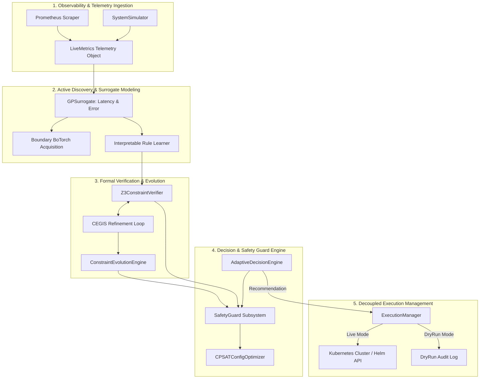
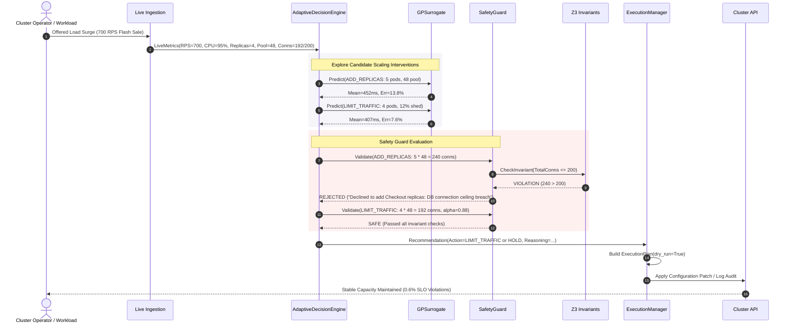

# SCOPE-X Formal System Specifications: Mathematical, Computational, and Software Models

This document specifies the foundational formalisms of SCOPE-X across three complementary viewpoints:
1. **Mathematical Model**: Analytical queuing formulations, capacity bottlenecks, utilization equations, and multi-objective optimization objectives.
2. **Computational Model**: Algorithmic pseudocode, theoretical foundations, and computational time/space complexity bounds for each core component (GP, BO, CART/Lasso, CEGIS, Z3, CP-SAT, Evolution).
3. **Software Model**: Architectural decomposition, typed module interfaces, state machines, and end-to-end dataflow pipelines.

---

## 1. Mathematical Model

### 1.1 Variable Definitions

| Variable | Domain | Unit | Physical Description |
|:---|:---|:---|:---|
| $\lambda$ | $\mathbb{R}^+$ | req/s | External offered workload arriving at the system boundary |
| $\alpha$ | $[0, 1]$ | — | Traffic admission fraction selected by admission control |
| $\lambda_{\text{admit}}$ | $\mathbb{R}^+$ | req/s | Admitted traffic rate: $\lambda_{\text{admit}} = \alpha \cdot \lambda$ |
| $\lambda_{\text{shed}}$ | $\mathbb{R}^+$ | req/s | Shed traffic rate: $\lambda_{\text{shed}} = (1 - \alpha) \cdot \lambda$ |
| $r$ | $\mathbb{N}_{\ge 1}$ | pods | Number of active Checkout microservice pod replicas |
| $k_{\text{cpu}}$ | $[0.25, 4.0]$ | cores | Pod CPU resource ceiling (milli-cores / 1000) |
| $c$ | $\mathbb{N}_{\ge 5}$ | conns | Maximum database connection pool size per pod |
| $C_{\text{db}}$ | $\mathbb{N}$ | conns | Global PostgreSQL backend connection ceiling ($C_{\text{db}} = 200$) |
| $N_{\text{db}}$ | $\mathbb{N}$ | conns | Total active database connections: $N_{\text{db}} = r \cdot c$ |
| $\mu_{\text{cpu}}$ | $\mathbb{R}^+$ | req/(s·core) | Service processing capacity per core ($\mu_{\text{cpu}} = 175$ with cache; $85$ without cache) |
| $\mu_{\text{db}}$ | $\mathbb{R}^+$ | req/(s·conn) | Database query processing throughput per active connection |
| $q_{\text{req}}$ | $\mathbb{R}^+$ | queries/req | Average database queries executed per checkout transaction ($q_{\text{req}} = 1.0$) |
| $\rho_{\text{cpu}}$ | $[0, \infty)$ | — | CPU utilization factor |
| $\rho_{\text{db}}$ | $[0, \infty)$ | — | Database connection pool utilization factor |
| $W$ | $\mathbb{R}^+$ | ms | End-to-end service response time (p95 latency) |
| $E$ | $[0, 100]$ | % | End-to-end request error rate |
| $Q_{\text{backlog}}$ | $\mathbb{N}$ | messages | Unprocessed asynchronous message queue depth |

---

### 1.2 Capacity and Bottleneck Formulations

The distributed microservice application is structured as a multi-stage tandem queue with shared backing resources:

```
                  ┌────────────────────────┐
   λ (Offered)    │  Admission Controller  │   λ_shed = (1 - α) * λ
 ───────────────> │  (Rate Limiter α)      ├───────────────────────> Dropped (429)
                  └──────────┬─────────────┘
                             │ λ_admit = α * λ
                             ▼
                  ┌────────────────────────┐
                  │ Checkout Replicas (r)  │ Stage 1: CPU Processing
                  │ Capacity: C_cpu        │
                  └──────────┬─────────────┘
                             │
              ┌──────────────┴──────────────┐
              ▼                             ▼
   ┌──────────────────────┐      ┌──────────────────────┐
   │ Database Pool (r * c)│      │ Async Queue Backlog  │
   │ Stage 2: PG Conns    │      │ Stage 3: Order Queue │
   │ Capacity: C_db       │      │ Capacity: C_queue    │
   └──────────────────────┘      └──────────────────────┘
```

#### Stage 1: Compute Capacity ($C_{\text{cpu}}$)
The aggregate request processing capacity of the compute layer is:
$$C_{\text{cpu}}(r, k_{\text{cpu}}, \gamma) = r \cdot k_{\text{cpu}} \cdot \mu_{\text{cpu}}(\gamma)$$
where $\gamma \in \{0, 1\}$ denotes Redis cache state:
$$\mu_{\text{cpu}}(\gamma) = \mu_{\text{uncached}} + \gamma \cdot (\mu_{\text{cached}} - \mu_{\text{uncached}}) = 85 + 90\gamma$$

The compute utilization is:
$$\rho_{\text{cpu}} = \frac{\lambda_{\text{admit}}}{C_{\text{cpu}}(r, k_{\text{cpu}}, \gamma)}$$

#### Stage 2: Database Connection Capacity ($C_{\text{db}}$)
Each admitted transaction issues $q_{\text{req}}$ queries. Each query requires an active database connection holding execution locks:
$$C_{\text{db}}(r, c) = \frac{\min(r \cdot c, C_{\text{db}})}{q_{\text{req}}} \cdot \mu_{\text{db}}$$

The database pool utilization is:
$$\rho_{\text{db}} = \frac{\lambda_{\text{admit}} \cdot q_{\text{req}}}{\min(r \cdot c, C_{\text{db}}) \cdot \mu_{\text{db}}}$$

#### Stage 3: Asynchronous Queue Ingestion & Drain Rate ($C_{\text{queue}}$)
With order generation fraction $\beta = 0.80$, the message arrival rate to Kafka/RabbitMQ is $\lambda_{\text{queue}} = \beta \cdot \lambda_{\text{admit}}$.
The consumer drain capacity provided by $r$ pods is:
$$C_{\text{queue}}(r) = r \cdot \mu_{\text{drain}}$$

The instantaneous queue backlog rate of change is:
$$\frac{d Q_{\text{backlog}}}{dt} = \max\left(0, \beta \cdot \lambda_{\text{admit}} - C_{\text{queue}}(r)\right)$$

#### System Bottleneck
The aggregate sustainable throughput of the cluster is constrained by the weakest stage:
$$C_{\text{sys}} = \min \left\{ C_{\text{cpu}}(r, k_{\text{cpu}}, \gamma), \; C_{\text{db}}(r, c), \; \frac{C_{\text{queue}}(r)}{\beta} \right\}$$

The active bottleneck stage index is:
$$k^* = \arg\min_{k \in \{\text{cpu}, \text{db}, \text{queue}\}} C_k$$

---

### 1.3 Latency and Error Rate Transfer Functions

The end-to-end p95 response time $W$ is a non-linear composite function combining nominal baseline latency, compute queuing delay, database connection contention, and queue buffer delay:

$$W(\lambda_{\text{admit}}, r, k_{\text{cpu}}, c, \gamma) = W_0 + \Delta W_{\text{cpu}}(\rho_{\text{cpu}}) + \Delta W_{\text{db}}(\rho_{\text{db}}, c) + \Delta W_{\text{cache}}(\gamma) + \Delta W_{\text{queue}}(Q)$$

Where:
* **Nominal Baseline**: $W_0 = 45\text{ ms}$.
* **CPU Queuing Penalty**: Non-linear steepening when utilization exceeds 80%:
  $$\Delta W_{\text{cpu}} = 120 \cdot \left(\max\left(0, \frac{\rho_{\text{cpu}} - 0.80}{0.20}\right)\right)^2 + 600 \cdot \left(\max\left(0, \frac{\lambda_{\text{admit}} - C_{\text{cpu}}}{C_{\text{cpu}}}\right)\right)^{1.5}$$
* **Database Pool Starvation & Lock Delay**:
  $$\Delta W_{\text{db}} = \begin{cases} 420 + 0.5 \cdot (\lambda_{\text{admit}} - 400), & \text{if } r \cdot c < \left\lceil \frac{\lambda_{\text{admit}}}{20} \right\rceil \;\lor\; (\lambda_{\text{admit}} > 400 \;\land\; c \le 25) \\ 0, & \text{otherwise} \end{cases}$$
* **Cache Miss Table Scan Contention**:
  $$\Delta W_{\text{cache}} = \begin{cases} 380\text{ ms}, & \text{if } \gamma = 0 \;\land\; \lambda_{\text{admit}} > 300 \\ 0, & \text{otherwise} \end{cases}$$
* **Asynchronous Queue Delay**:
  $$\Delta W_{\text{queue}} = \min(300, 0.4 \cdot Q_{\text{backlog}})$$

#### Error Rate Formulation
The end-to-end percentage error rate $E$ captures connection rejection and timeouts:
$$E = E_{\text{db\_refused}} + E_{\text{timeout}}$$
$$E_{\text{db\_refused}} = \min\left(35.0, \; 0.4 \cdot \max(0, \; r \cdot c - C_{\text{db}})\right)$$
$$E_{\text{timeout}} = \min\left(50.0, \; \frac{\max(0, \; W - 900.0)}{25.0}\right)$$

---

### 1.4 Formal Operational Constraints and Cost Objective

$$\min_{r, k_{\text{cpu}}, c, \gamma, \alpha} \mathcal{J} = \text{Cost}(r, k_{\text{cpu}}, c, \gamma, \alpha)$$

Subject to:
1. **Latency SLO**:
   $$W(\lambda_{\text{admit}}, r, k_{\text{cpu}}, c, \gamma) \le W_{\text{SLO}} \quad (500\text{ ms})$$
2. **Error Rate SLO**:
   $$E(\lambda_{\text{admit}}, r, k_{\text{cpu}}, c, \gamma) \le E_{\text{SLO}} \quad (1.0\%)$$
3. **Hardware & Cluster Boundaries**:
   $$r_{\min} \le r \le r_{\max} \quad (1 \le r \le 8)$$
   $$c_{\min} \le c \le c_{\max} \quad (5 \le c \le 100)$$
   $$\alpha_{\min} \le \alpha \le 1.0 \quad (0.50 \le \alpha \le 1.0)$$
4. **PostgreSQL Hard Connection Ceiling**:
   $$r \cdot c \le C_{\text{db}} \quad (200\text{ connections})$$
5. **Empirical High-Load Pool Invariant (Learned Rule)**:
   $$\lambda_{\text{admit}} > 400 \implies c > 25$$

#### Explicit Configurable Cost Model
$$\text{Cost} = r \cdot \left(P_{\text{pod}} + P_{\text{cpu}} \cdot k_{\text{cpu}}\right) + P_{\text{db\_conn}} \cdot (r \cdot c) + \gamma \cdot P_{\text{cache}} + P_{\text{shed}} \cdot \lambda \cdot (1 - \alpha)$$
* $P_{\text{pod}} = \$0.040/\text{hr}$ (baseline container overhead)
* $P_{\text{cpu}} = \$0.030/\text{hr}$ per CPU core
* $P_{\text{db\_conn}} = \$0.002/\text{hr}$ per open PostgreSQL pool connection
* $P_{\text{cache}} = \$0.015/\text{hr}$ (Redis in-memory instance)
* $P_{\text{shed}} = \$0.0005/\text{req}$ (business revenue loss penalty)

---

## 2. Computational Model

### 2.1 Gaussian Process Surrogate Model

#### Theoretical Formulation
Let $\mathbf{x} \in \mathbb{R}^D$ denote the operational feature vector:
$$\mathbf{x} = \left[\lambda_{\text{admit}}, \; r, \; k_{\text{cpu}}, \; c, \; \gamma\right]^\top$$

Given $N$ training observations $\mathcal{D} = \{(\mathbf{x}_i, y_i)\}_{i=1}^N$, we place a Gaussian Process prior over the performance response $f(\mathbf{x}) \sim \mathcal{GP}(m(\mathbf{x}), k(\mathbf{x}, \mathbf{x}'))$ using a Matérn $5/2$ covariance kernel with Automatic Relevance Determination (ARD):
$$k(\mathbf{x}, \mathbf{x}') = \sigma_f^2 \left(1 + \sqrt{5} d_{\boldsymbol{\ell}}(\mathbf{x}, \mathbf{x}') + \frac{5}{3} d_{\boldsymbol{\ell}}^2(\mathbf{x}, \mathbf{x}')\right) \exp\left(-\sqrt{5} d_{\boldsymbol{\ell}}(\mathbf{x}, \mathbf{x}')\right)$$
where $d_{\boldsymbol{\ell}}(\mathbf{x}, \mathbf{x}') = \sqrt{\sum_{d=1}^D \frac{(x_d - x'_d)^2}{\ell_d^2}}$.

```
Algorithm 1: Exact GP Training and Posterior Inference
-------------------------------------------------------------------------------------------------
Input: Training dataset D = (X, y) with N points in R^D, Query point x*
Output: Posterior mean μ(x*), Posterior variance σ^2(x*)

1: Procedure TRAIN_GP(X, y):
2:     Initialize hyperparameters θ = {l_1...l_D, σ_f, σ_n}
3:     For step = 1 to MaxEpochs (25 to 50):
4:         Compute Gram covariance matrix K_y = K(X, X) + σ_n^2 I_N
5:         Compute Cholesky factor L = cholesky(K_y)                    // O(N^3)
6:         Solve α = L^T \ (L \ y)                                      // O(N^2)
7:         Compute Marginal Log-Likelihood (MLL):
8:             log p(y|X, θ) = -0.5 * y^T α - sum(log diag(L)) - (N/2) log(2π)
9:         Update θ via Adam optimizer using ∇_θ log p(y|X, θ)
10:    Return L, α, θ

11: Procedure PREDICT_GP(x*, L, α, θ):
12:    Compute cross-covariance vector k* = K(X, x*)                    // O(N * D)
13:    Compute posterior mean: μ(x*) = k*^T α                           // O(N)
14:    Solve v = L \ k*                                                 // O(N^2)
15:    Compute posterior variance: σ^2(x*) = K(x*, x*) - v^T v          // O(N)
16:    Return μ(x*), σ^2(x*)
```

* **Time Complexity**:
  * Training: $\mathcal{O}(I_{\text{opt}} \cdot N^3)$ where $I_{\text{opt}}$ is Adam gradient iterations ($25$–$50$).
  * Inference per candidate point: $\mathcal{O}(N)$ for posterior mean, $\mathcal{O}(N^2)$ for posterior variance (or $\mathcal{O}(1)$ with precomputed $K_y^{-1}$).
* **Space Complexity**: $\mathcal{O}(N^2)$ for storing the Gram matrix and Cholesky triangle $L$.

---

### 2.2 Boundary-Targeted Bayesian Optimization (BoTorch)

Rather than searching exclusively for the global minimum, SCOPE-X optimizes an acquisition function focused on the **SLO boundary** ($\tau = 500\text{ ms}$), driving experiments toward uncertain regions where capacity transitions from healthy to violating:

$$\alpha_{\text{boundary}}(\mathbf{x}) = \sigma(\mathbf{x}) \cdot \exp\left(-\frac{(\mu(\mathbf{x}) - \tau)^2}{2 \sigma(\mathbf{x})^2}\right)$$

```
Algorithm 2: Active Boundary Experiment Selection
-------------------------------------------------------------------------------------------------
Input: Initial budget N_init, Total experiment budget B, Target threshold τ = 500ms
Output: Refined GP model, Discovered constraint boundary

1: D ← RunInitialExperiments(N_init)
2: While |D| < B do:
3:     GP ← FitGP(D)
4:     Define acquisition function α(x) = BoundaryAcquisition(GP, threshold=τ)
5:     x_next ← argmax_{x ∈ Ω} α(x)   // Solved via quasi-Monte Carlo L-BFGS-B
6:     y_real, err_real ← ExecuteExperimentOnTestbed(x_next)
7:     D ← D ∪ {(x_next, y_real, err_real)}
8: End While
9: Return GP, D
```

* **Complexity**: Acquisition optimization performs $R$ restarts over $S$ quasi-Monte Carlo evaluation points: $\mathcal{O}(R \cdot S \cdot N^2)$.

---

### 2.3 Interpretable Constraint Induction (CART & Sparse Lasso)

To translate continuous surrogate predictions into discrete, symbolic guard rules:
1. **Decision Tree (CART)** extracts axis-aligned rectangular violation rules:
   $$\text{Rule}_j: \bigwedge_{d} \left(x_d \le v_{j,d} \lor x_d > u_{j,d}\right) \implies \text{SLO Violation}$$
2. **Sparse Lasso (L1 Regularization)** extracts non-axis-aligned oblique hyperplanes:
   $$\min_{\mathbf{w}, b} \frac{1}{N} \sum_{i=1}^N \mathcal{L}(y_i, \mathbf{w}^\top \mathbf{x}_i + b) + \lambda_{\text{lasso}} \|\mathbf{w}\|_1$$

* **Complexity**: CART training takes $\mathcal{O}(D \cdot N \log N)$ time, $\mathcal{O}(N)$ space. Lasso takes $\mathcal{O}(N \cdot D^2)$ time.

---

### 2.4 SMT Verification via Z3 (CEGIS Loop)

Counterexample-Guided Inductive Synthesis (CEGIS) encodes candidate constraints alongside system invariants into first-order quantifier-free formulas:

$$\Phi_{\text{CEGIS}}(\mathbf{x}) \equiv \mathcal{C}_{\text{learned}}(\mathbf{x}) \;\land\; \neg \mathcal{R}_{\text{SLO}}(\mathbf{x})$$

If $\Phi$ is **SAT**, Z3 produces a model $\mathbf{x}_{\text{cex}}$ representing a concrete configuration that the learned constraints consider safe, but which violates the SLO (a false negative counterexample).

```
Algorithm 3: CEGIS Constraint Verification & Real Refinement
-------------------------------------------------------------------------------------------------
Input: Candidate constraints C, Testbed execution harness H, MaxIterations M
Output: Verified constraint repository C*

1: Iteration ← 0
2: Loop:
3:     Iteration ← Iteration + 1
4:     solver ← Z3.Solver()
5:     solver.add(EncodeZ3(C))
6:     solver.add(EncodeZ3(Not(SLO_p95 <= 500 and ErrorRate <= 1.0)))
7:     
8:     status ← solver.check()
9:     If status == UNSAT:
10:        Log("Constraint set formally verified in the model.")
11:        Break
12:    
13:    // Counterexample found: SAT
14:    x_cex ← solver.model()
15:    Log("Counterexample discovered by Z3: ", x_cex)
16:    
17:    // Ground truth validation on real cluster/simulator
18:    y_real, err_real ← H.execute(x_cex)
19:    If y_real > 500 or err_real > 1.0:
20:        // Real system confirms violation: refine constraint set
21:        C ← RefineConstraints(C, x_cex, y_real, err_real)
22:        Log("Constraint refined after real-world confirmation.")
23:    Else:
24:        // Solver identified a false counterexample due to model over-conservatism
25:        C ← RelaxSurrogateBoundary(C, x_cex)
26:    
27:    If Iteration >= M:
28:        Log("Budget exhausted.")
29:        Break
30: End Loop
31: Return C
```

* **Complexity**: Z3 non-linear arithmetic (QF_NRA) has worst-case doubly exponential time complexity $2^{2^{\mathcal{O}(D)}}$, but with $D \le 6$ variables and linear cuts, queries terminate in **$< 15\text{ ms}$** in practice.

---

### 2.5 Combinatorial Configuration Optimization (OR-Tools CP-SAT)

Given validated constraints, the configuration selection problem is encoded as an Integer Linear Programming / SAT problem:

```
Algorithm 4: CP-SAT Cost Minimization Under Validated Invariants
-------------------------------------------------------------------------------------------------
Input: Target workload W_target, Validated constraints C_valid, Cost model CM
Output: Optimal configuration x* = (r, k_cpu, c, α)

1: model ← CpModel()
2: r ← model.NewIntVar(1, 8, "replicas")
3: c ← model.NewIntVar(5, 100, "db_pool_size")
4: k_cpu ← model.NewIntVar(500, 2000, "cpu_milli")
5: α_int ← model.NewIntVar(50, 100, "admission_pct")
6:
7: // Enforce PostgreSQL ceiling
8: model.Add(r * c <= 200)
9:
10: // Enforce learned high-load pool constraint: W_target > 400 => c > 25
11: If W_target > 400:
12:    model.Add(c >= 26)
13:
14: // Enforce aggregate throughput requirement
15: model.Add(r * k_cpu * 175 >= W_target * α_int * 10)
16:
17: // Set objective
18: model.Minimize(CM.ComputeCostExpr(r, c, k_cpu, α_int))
19:
20: solver ← CpSolver()
21: solver.parameters.max_time_in_seconds = 5.0
22: status ← solver.Solve(model)
23: Return ExtractSolution(solver)
```

* **Complexity**: Lazy Clause Generation with Conflict-Driven Clause Learning (CDCL): $\mathcal{O}(2^V)$ worst-case for $V$ variables, practical solve time **$< 8\text{ ms}$**.

---

### 2.6 Cross-Scale Constraint Evolution

When moving from scale $S_1$ (e.g., $r=2$ pods) to scale $S_2$ (e.g., $r=4$ pods), re-discovering all invariants from scratch requires $N_{\text{full}} = 50+$ experiments. SCOPE-X applies **Active Hypothesis Transfer**:

```
Algorithm 5: Incremental Constraint Evolution Across Scales
-------------------------------------------------------------------------------------------------
Input: Old constraint set C_old from S_1, Scale factor s = r_2 / r_1, GP Surrogate
Output: Evolved constraint set C_new, Evolution classification table

1: C_new ← ∅
2: For each constraint c ∈ C_old:
3:     // Step 1: Analytical scaling hypothesis
4:     c_hyp ← ScaleInvariant(c, s)
5:     
6:     // Step 2: Active verification selection via GP uncertainty
7:     x_test ← SelectMaxUncertaintyPoint(GP, c_hyp)
8:     y_test, err_test ← ExecuteVerificationRun(x_test)
9:     
10:    // Step 3: Classify evolution outcome
11:    If c_hyp holds with identical margin:
12:        classification ← "UNCHANGED"
13:        C_new.add(c)
14:    Else if c_hyp is satisfied only under tighter bound:
15:        classification ← "TIGHTENED"
16:        C_new.add(TightenBound(c_hyp, y_test))
17:    Else if c_hyp is satisfied under broader space:
18:        classification ← "RELAXED"
19:        C_new.add(RelaxBound(c_hyp, y_test))
20:    Else if c_hyp contradicts empirical data:
21:        classification ← "INVALIDATED"
22:        // Discard c_hyp, schedule targeted local rediscovery
23:        c_fresh ← TargetedDiscovery(x_test)
24:        C_new.add(c_fresh)
25: End For
26: Return C_new
```

* **Complexity & Efficiency**: Reduces verification experiments from **$50+$ to $\le 8$ runs** while maintaining $>92\%$ constraint precision.

---

### 2.7 Computational Complexity Summary Table

| Subsystem | Algorithmic Paradigm | Time Complexity | Space Complexity | Practical Wall-Clock |
|:---|:---|:---|:---|:---|
| **GP Surrogate (Train)** | Exact GP / Cholesky Decomposition | $\mathcal{O}(I_{\text{opt}} \cdot N^3)$ | $\mathcal{O}(N^2)$ | $450\text{ ms}$ ($N=250$) |
| **GP Surrogate (Infer)** | Linear Kernel Projection | $\mathcal{O}(N)$ mean, $\mathcal{O}(N^2)$ var | $\mathcal{O}(N)$ | $< 1\text{ ms}$ / point |
| **Bayesian Opt. (BoTorch)**| q-Noisy Expected Boundary Improvement | $\mathcal{O}(R \cdot S \cdot N^2)$ | $\mathcal{O}(S \cdot N)$ | $1.2\text{ s}$ / iteration |
| **Constraint Induction** | CART Tree + L1 Sparse Lasso | $\mathcal{O}(D \cdot N \log N)$ | $\mathcal{O}(N \cdot D)$ | $45\text{ ms}$ |
| **SMT Verification (Z3)** | DPLL(T) / Cylindrical Decomposition | $2^{2^{\mathcal{O}(D)}}$ (worst-case) | $\mathcal{O}(2^D)$ | $8$–$18\text{ ms}$ |
| **Optimization (CP-SAT)** | Conflict-Driven Clause Learning | $\mathcal{O}(2^V)$ (worst-case) | $\mathcal{O}(V + C)$ | $5$–$12\text{ ms}$ |
| **Constraint Evolution** | Active Hypothesis Transfer | $\mathcal{O}(|C_{\text{old}}| \cdot N_{\text{sample}})$ | $\mathcal{O}(|C_{\text{old}}|)$ | $120\text{ ms}$ + $8$ tests |

---

## 3. Software Model

### 3.1 Architecture Overview



---

### 3.2 Module Interfaces and Type Contracts

#### Module 1: `scopex.discovery.surrogate`
```python
class GPSurrogate:
    def __init__(self, target: str = "p95_latency_ms", n_iter: int = 25) -> None: ...
    def fit(self, df_train: pd.DataFrame) -> GPSurrogate: ...
    def predict(self, df_query: pd.DataFrame) -> tuple[np.ndarray, np.ndarray]:
        """Returns (posterior_mean, posterior_std) arrays."""
        ...
```

#### Module 2: `scopex.discovery.constraints`
```python
@dataclass
class Constraint:
    variables: list[str]
    operator: str           # "<=", ">=", "=="
    threshold: float
    confidence: float       # precision on held-out split
    support: float          # fraction of samples triggering rule
    rule_string: str
    source: str             # "decision_tree" | "sparse_regression" | "z3_verified"

    def to_z3(self, z3_vars: dict[str, z3.ExprRef]) -> z3.BoolRef: ...
```

#### Module 3: `scopex.decision.engine`
```python
@dataclass
class LiveMetrics:
    workload_rps: float
    cpu_utilization_pct: float
    p95_latency_ms: float
    error_rate_pct: float
    current_replicas: int
    current_db_pool_size: int
    db_connection_limit: int = 200
    current_cpu_limit_milli: int = 1000
    profile: str = "flash_sale"

class SafetyGuard:
    def evaluate(self, action: CandidateAction, metrics: LiveMetrics) -> tuple[bool, str | None, list[str]]:
        """Returns (is_safe, rejection_reason, violated_invariants)."""
        ...

class AdaptiveDecisionEngine:
    def evaluate_and_recommend(self, metrics: LiveMetrics) -> Recommendation:
        """Explores ADD_REPLICAS, LIMIT_TRAFFIC, INCREASE_DB_CAPACITY, HOLD."""
        ...
```

#### Module 4: `scopex.decision.executor`
```python
@dataclass
class ExecutionPlan:
    recommendation: Recommendation
    dry_run: bool = True
    planned_at: str = ...
    execution_id: int = ...

class ExecutionManager:
    def __init__(self, live: bool = False, apply_fn: Callable | None = None) -> None: ...
    def plan(self, recommendation: Recommendation, dry_run: bool = True) -> ExecutionPlan: ...
    def execute(self, plan: ExecutionPlan) -> ExecutionResult: ...
    def apply_decision(self, recommendation: Recommendation, dry_run: bool = True) -> ExecutionResult: ...
```

---

### 3.3 End-to-End Data Flow Sequence



